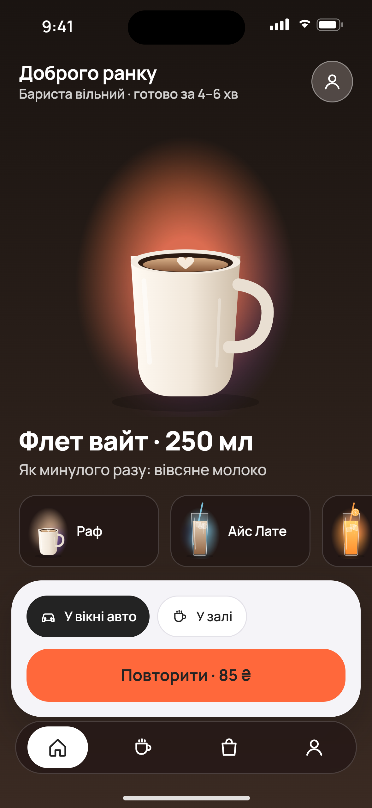
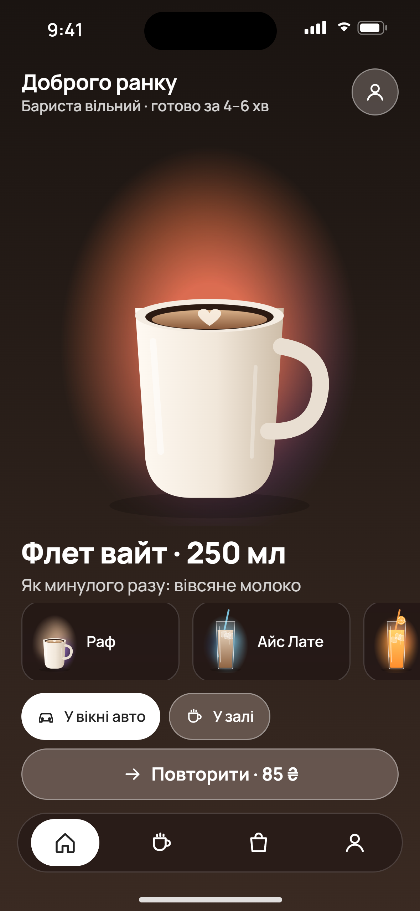
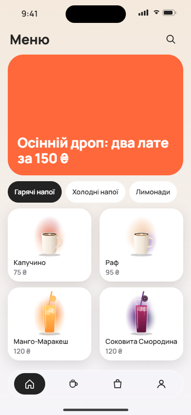
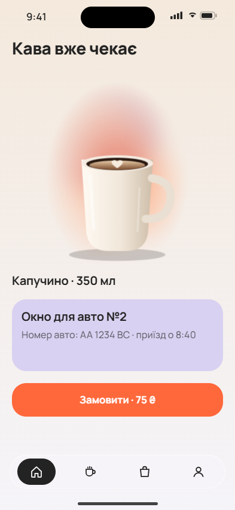

# DRIVE&KAVA AI Studio

Автономная продуктовая и дизайн-студия для приложения DRIVE&KAVA: команда
AI-специалистов исследует проблему, спорит, создаёт варианты экранов, проверяет их
фактами и критикой, дорабатывает и присылает владельцу в Telegram **готовый
результат** на утверждение. Решения фиксируются в GitHub.

Архитектура — [docs/ARCHITECTURE.md](docs/ARCHITECTURE.md) (13 разделов брифа).
Аудит bld-team — [docs/BLD-TEAM-AUDIT.md](docs/BLD-TEAM-AUDIT.md). Что нужно
подключить — [docs/SETUP.md](docs/SETUP.md).

## Статус на 15.10.2026 — честно

| Часть | Статус |
|---|---|
| Архитектура, ADR, аудит bld-team, факты AWS | ✅ готово |
| Оргструктура: 44 роли × 13 полей, кастинг, рубрика, политики | ✅ готово |
| База знаний из исследования (тиры A–D, права) + карточки методов | ✅ готово, архив ссылок разобран |
| Школы практиков Drinkit / Dodo / amo / студий: 30 досье, 139 приёмов, 98 источников, у каждой роли основная и дополнительные школы | ✅ готово ([docs/PRACTITIONERS.md](docs/PRACTITIONERS.md)), проверено тестами |
| Реальное окно выдачи: фото владельца, маршрут, правила подсказки «Заберу у вікні»; оплата только на месте (готівка / картка) | ✅ в контексте агентов, критики видят фото ([product/space/drive-window.md](product/space/drive-window.md)); маршрут и оплата картой у окна (терминал подают из окна) подтверждены владельцем |
| Конвейер: триаж → позиции → бриф → варианты → рендер → автопроверки → слепая критика → выбор → доработка → gate → доставка → правки → одобрение | ✅ работает, проверен тестами |
| Рендер экранов из Screen Spec в PNG @3x + 14 автопроверок по DOM (включая «нет онлайн-оплаты» и «окно одно») | ✅ работает на установленном Chrome |
| Маршрутизатор моделей, бюджет с резервированием, circuit breaker | ✅ проверено тестами |
| Устойчивость: журнал шагов, outbox, повторные сообщения, падения процесса | ✅ проверено тестами |
| Telegram-бот (кнопки, правки, история, бюджет, только владелец) | ✅ проверен на поддельном Bot API; ⏳ живой бот — нужен токен |
| GitHub: ветки studio/*, PR, merge только после одобрения и только studio/ | ✅ проверен на поддельном API; ⏳ живой репозиторий недоступен |
| Bedrock: Converse, Stability | ✅ формат запросов проверен тестами; ⏳ живые вызовы — нужен API-ключ |
| Сравнительное тестирование моделей (10 задач) | ✅ харнесс готов; ⏳ запуск — нужен ключ |
| Запуск в GitHub Actions: каждый час днём (08:00–23:00 по Киеву), ночью не работает и не тратит деньги; состояние зашифровано в ветке `studio-state` | ✅ код и тесты сбоев (ADR-0007); ⏳ первый живой запуск — нужны секреты ([docs/SETUP.md](docs/SETUP.md)) |
| AWS (Step Functions, DynamoDB, S3, AgentCore) | запасной вариант для работы 24/7, черновик в `infra/`, не развёрнут |
| Автономные инициативы | ⏳ этап 6 |

**Важно.** Пока нет ключа Bedrock, конвейер прогоняется на сценарном провайдере:
он проверяет механику (маршрутизацию, бюджет, журнал, рендер, проверки, выбор,
правки, утверждение, GitHub), но не доказывает качество дизайна. Качество
появится с живыми моделями и будет измеряться eval-набором.

## Как это выглядит

Демо-прогон (сценарные модели, напитки — векторные заглушки до генерации фото):

| v1 (после внутренней доработки) | v2 (после правок владельца) | Отсеяно фактами |
|---|---|---|
|  |  |   |

Варианты b и c отсеяны автопроверками, а не вкусом: у b промо-баннер 27% экрана
(предпочтение владельца) и белый текст на оранжевом 2.88:1; у c — русское «Окно»,
номер окна «№2» (у DRIVE&KAVA окно одно) и недостаточный контраст. v2 — правки «уберите плашку, кнопки прозрачнее, напиток
крупнее».

## Запуск

Нужен Node.js 24 и установленный Chrome или Edge.

```bash
npm install
```

```bash
npm test
```

```bash
npm run demo
```

С живыми моделями: скопировать `.env.example` в `.env`, вписать
`AWS_BEARER_TOKEN_BEDROCK`, затем:

```bash
npm run check:bedrock
```

```bash
npm run studio -- new "Главный экран: долго ищу нужный напиток"
```

С Telegram (вписать `TELEGRAM_BOT_TOKEN`, `TELEGRAM_OWNER_ID`):

```bash
npm run telegram
```

Основной режим — GitHub Actions: секреты репозитория и управление (запуск сейчас,
пауза, выключение, рабочие часы) описаны в [docs/SETUP.md](docs/SETUP.md).

```bash
gh workflow run studio.yml -f task="Главный экран: долго ищу нужный напиток"
```

## Структура

```
docs/            архитектура, ADR, аудит, факты AWS, настройка, демо-рендеры
studio/org/      роли (a–f), школы практиков, кастинг, рубрика
studio/policies/ модели и цены, бюджет, этапы утверждения, права инструментов
studio/context/  продукт, реестр предпочтений владельца
studio/evals/    10 эталонных задач для выбора моделей
knowledge/       источники, методы, досье школ (тиры A–D, M)
design-system/   токены v0.1 (черновик), принципы, шрифт Manrope (OFL)
product/         снимок каталога v82; space/ — фото и описание окна выдачи
src/             ядро студии (TypeScript, Node.js 24, без сборки)
test/            59 тестов, включая сквозной сценарий, сбои и сессии Actions
.github/         CI и workflow «Студия» (сессии днём, ADR-0007)
infra/           запасной вариант AWS и черновик Step Functions
```
