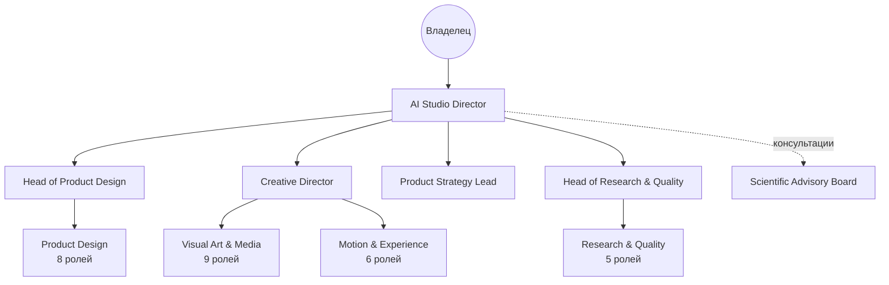
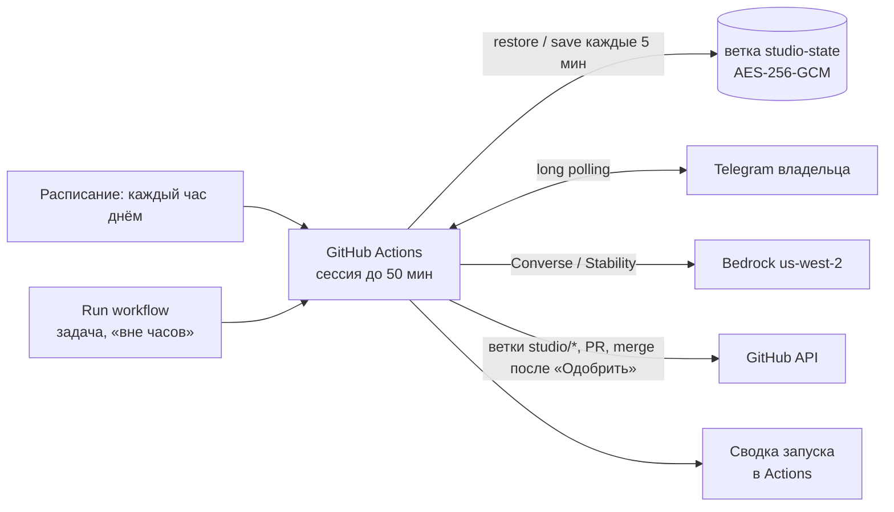

# DRIVE&KAVA AI Studio — архитектура

Версия 0.1 · 15.10.2026 · владелец продукта: Валентин (DRIVE&KAVA)

> **Статус честно.** Этот документ — целевая архитектура. В репозитории реализовано
> и проверено тестами локальное ядро (см. раздел 13 и `README.md`). В AWS ничего
> не развёрнуто, живые вызовы Bedrock, Telegram и GitHub ещё не выполнялись —
> для них нужны доступы, перечисленные в [SETUP.md](SETUP.md).

Документ отвечает на 13 вопросов из брифа. Факты об AWS сверены с документацией
на 15.10.2026 — источники в [AWS-FACTS-2026-10.md](AWS-FACTS-2026-10.md).
Аудит bld-team — в [BLD-TEAM-AUDIT.md](BLD-TEAM-AUDIT.md). Ключевые решения
оформлены как ADR в [docs/adr](adr).

---

## 1. Product Vision — что мы строим

**DRIVE&KAVA AI Studio** — производственная система, которая превращает проблему
продукта в утверждённый владельцем дизайн-результат: готовый экран, состояния,
ассеты, правила движения и спецификацию для разработки.

Главное архитектурное утверждение: студия — это **конвейер производства
артефактов с встроенной профессиональной критикой**, а не чат персонажей.
Агенты нужны там, где требуется суждение (что делать, как оценить, что
исправить). Всё остальное — маршрутизация, бюджеты, статусы, отправка в
Telegram, коммиты, измеримые проверки — делает обычный код.

Пять принципов, из которых выводится всё остальное:

1. **Экраны — это код, а не картинки.** Генераторы изображений не умеют
   стабильно рисовать интерфейс с правильной украинской типографикой,
   выверенными отступами и состояниями. Поэтому агенты пишут структурированную
   спецификацию экрана (Screen Spec), рендерер собирает её из токенов
   дизайн-системы в HTML/CSS, а headless Chromium снимает пиксельно точный PNG в
   разрешении устройства (и видео для движения). Генеративные модели делают
   только то, что умеют хорошо: фотографию напитка и сцены, которые
   вставляются в экран слоями. ([ADR-0002](adr/ADR-0002-screens-as-code.md))
2. **Сначала факты, потом мнения** (урок Review Gate из bld-team). Перед любой
   LLM-критикой результат проходит автоматические проверки по отрендеренному
   DOM: контраст, размеры касаний, язык интерфейса, безопасные зоны, зона
   большого пальца, перекрытие напитка непрозрачными элементами. Критики видят
   эти факты и не могут их «переспорить».
3. **Агент ≠ модель.** Агент — это профессиональный профиль, база знаний,
   инструменты, память и формат результата. Модель выбирает маршрутизатор под
   класс задачи по измеренному качеству и цене. Замена модели не меняет агента.
   ([ADR-0006](adr/ADR-0006-agent-not-model.md))
4. **Владелец утверждает версии, а не намерения.** Каждое одобрение привязано к
   хэшу конкретной версии артефакта. Молчание — не согласие. Одобрение дизайна
   не разрешает разработку, разработка не разрешает выпуск.
5. **Бюджет — жёсткий предохранитель в коде.** Перед дорогой операцией —
   оценка стоимости и резерв средств; при превышении — пауза и честное
   сообщение, а не тихая деградация качества.

### Как выглядит один цикл

```mermaid
flowchart LR
  T[Telegram: задача владельца\nили автономная инициатива] --> I[Intake + триаж\n(economy-модель)]
  I --> C[Кастинг: кто нужен\n(таблица, не LLM)]
  C --> R[Исследование:\nзнания + память + текущий экран]
  R --> P[Независимые позиции\nспециалистов]
  P --> B[Бриф + 2–3 направления]
  B --> V[Варианты: Screen Spec +\nфото-брифы + motion]
  V --> G[Генерация фото\n(Stability)]
  G --> X[Рендер PNG/видео\n(headless Chromium)]
  X --> F[Автопроверки\n(факты)]
  F --> K[Слепая критика\nпо рубрике]
  K --> S[Выбор + доработка\n≤2 итераций]
  S --> Q{Финальный\nquality gate}
  Q -- не прошёл --> H[Пауза + отчёт о блокере\n(черновик не отправляется)]
  Q -- прошёл --> D[Telegram: готовый экран\nОдобрить / Доработать / Отклонить]
  D -- Одобрить --> GH[GitHub: решение,\nспецификация, PR]
  D -- Доработать --> FB[Замечания → правки +\nкандидаты в предпочтения] --> S
  D -- Отклонить --> L[Причина → память ошибок]
```

---

## 2. Team Structure — организация

Организация повторяет устройство сильной дизайн-студии, но **роль в оргсхеме и
вызов модели — разные вещи**. Каждая роль описана профилем из 13 полей
(`studio/org/roles/*.json`): область, ответственность, метод решений, критерии
качества, методы исследования, ориентиры, источники знаний, сильные стороны,
риски, поводы спорить, инструменты, формат результата, правила передачи.

У роли три режима работы, их выбирает кастинг:

| Режим | Что это | Когда |
|---|---|---|
| `agent` | Отдельный вызов модели со своим профилем и знаниями | Позиции, авторство вариантов, критика (нужна независимость) |
| `lens` | Секция внутри общего «панельного» вызова | Узкие проверки, где независимость не критична (фуд-стайлинг + свет + сет-дизайн для фото-брифа) |
| `check` | Детерминированная проверка кодом | Всё, что измеримо: контраст, касания, язык, сетка |

Так 44 роли не превращаются в 44 дорогих вызова на каждую задачу.

### Отделы и подчинение



- **A. Leadership:** Studio Director (оркестрация, бюджет, приоритеты, отправка
  владельцу), Head of Product Design (целостность UX), Creative Director
  (визуальное направление), Product Strategy Lead (гипотезы, бизнес-смысл).
- **B. Product Design:** Senior Product Designer, Mobile UI Designer, UX
  Architect, Design System Designer, Interaction Designer, Accessibility
  Specialist, Design Researcher, Visual Interface Critic.
- **C. Visual Art & Media:** Beverage Art Director, Commercial Product
  Photographer, Set Designer, Food Stylist, Color & Lighting Artist, Retouching
  Specialist, CGI/3D Visual Artist, AI Image Production Specialist, Video &
  Motion Art Director.
- **D. Motion & Experience:** Motion Designer, Microinteraction Designer,
  Interaction Physics Consultant, Haptics Consultant, Spatial UI Designer,
  Animation Quality Reviewer.
- **E. Research & Quality:** UX Quality Reviewer, Cognitive Load Analyst,
  One-Hand Ergonomics Reviewer, Consistency Auditor, Visual Asset QA.
- **F. Scientific Advisory Board** — раздел 11.

**Право вето** (без него критика превращается в комплименты): UX Quality
Reviewer и Accessibility Specialist могут заблокировать вариант, если ссылаются
на проваленную автопроверку или конкретный сценарий провала; Creative Director —
если ссылается на нарушенный принцип бренда по его ID. Вето без доказательства
отклоняется кодом (схема ответа требует поле `evidence`).

**Ядро первого этапа** (7 ролей, остальные — `planned`): Studio Director,
Creative Director, Senior Product Designer, Beverage Art Director, Motion
Designer, UX Quality Reviewer, Technical Advisor (Interaction Physics).
Автор вариантов никогда не входит в число их критиков (`studio/org/casting.json`).

---

## 3. AWS Architecture

### Где студия работает сейчас: GitHub Actions, только днём (ADR-0007)

Владелец решил не разворачивать студию в отдельном облаке AWS: всё под рукой в
репозитории. Bedrock остаётся только поставщиком моделей (ключ API).



- **Часы:** `studio/policies/schedule.json` (08:00–23:00 по Киеву). Вне часов сессия
  выходит без вызовов моделей; за 5 минут до закрытия новые шаги не начинаются,
  инициатива встаёт на паузу `schedule` и утром продолжается с того же шага.
- **Состояние:** `.studio-data` и файлы студии в `studio/` — в ветке `studio-state`,
  зашифровано ключом `STUDIO_STATE_KEY`, один коммит без истории, запись с
  `--force-with-lease`; абсолютные пути переносятся на новую машину.
- **Управление:** `STUDIO_ENABLED=off`, Run workflow, `/pause` и `/resume`, сводка
  запуска; секреты — в Settings репозитория (docs/SETUP.md).
- **Код:** `src/runtime/schedule.ts`, `state.ts`, `session.ts`; команда
  `npm run studio -- actions-session`; тесты `test/runtime.test.ts` (сквозной
  сценарий «вечер → стёртая машина → утро»).

Схема AWS ниже остаётся вариантом на случай, если понадобится работа 24/7 или
мгновенный ответ бота ночью; черновик — в `infra/`.

### Целевая схема AWS (запасной вариант)

```mermaid
flowchart LR
  TG[Telegram] -->|webhook + secret| FURL[Lambda Function URL\ntelegram-webhook]
  FURL --> DDB[(DynamoDB\nstate, ledger, outbox)]
  FURL -->|SendTaskSuccess| SFN[Step Functions Standard\nконвейер инициативы]
  EB[EventBridge Scheduler\nаудит, напоминания] --> SFN
  SFN --> L1[Lambda: шаги агентов\n(model router)]
  L1 --> BR[Bedrock Runtime\nConverse / InvokeModel]
  L1 --> MEM[AgentCore Memory]
  L1 --> KB[Knowledge Base\nS3 Vectors]
  SFN --> RT[AgentCore Runtime (Node.js)\nшаги с инструментами]
  RT --> GW[AgentCore Gateway + Policy\nинструменты как MCP]
  SFN --> REN[Рендер: AgentCore Browser\nили Lambda-контейнер Chromium]
  REN --> S3[(S3: ассеты, рендеры, видео)]
  SFN --> PUB[Lambda: GitHub publisher]
  PUB --> GH[GitHub designe-2026]
  L1 & RT & REN --> OBS[CloudWatch + AgentCore Observability]
  SM[Secrets Manager] --> FURL & PUB & L1
```

| Потребность | Решение | Почему так |
|---|---|---|
| Надёжный многошаговый процесс, восстановление после сбоев | **Step Functions Standard** | Состояние каждого шага хранится AWS, ретраи и таймауты декларативны, `waitForTaskToken` ждёт решения владельца до года без опроса. Есть нативная интеграция с AgentCore harness. |
| Ожидание владельца | `waitForTaskToken` + запись в DynamoDB | Нет таймера, который превращает молчание в одобрение. Напоминания — отдельным расписанием. |
| Вызов моделей | **Bedrock Runtime: Converse API** | Единый формат сообщений, инструментов и изображений для всех провайдеров; поле `usage` даёт точные токены для учёта денег. Mantle (OpenAI-совместимый) — только для моделей, которых нет в Runtime. |
| Простые шаги агентов | **Lambda (Node.js 24)** | Один структурированный вызов модели с подготовленным кодом контекстом не нуждается в агентном рантайме. Дёшево и предсказуемо. |
| Шаги с открытым использованием инструментов (исследование с веб-поиском, многоходовая доработка) | **AgentCore Runtime** (Node.js direct code deploy, с апреля 2026) или **AgentCore harness** | Изолированные microVM-сессии, наблюдаемость. Подключаем, когда роль реально нуждается в цикле инструментов. |
| Инструменты | **AgentCore Gateway + Policy** | Инструменты (GitHub, рендер, генерация фото, поиск по знаниям) как MCP-цели; Policy (Cedar) запрещает ролям то, что им не положено, вне кода агента. До переезда — та же таблица прав в коде (`studio/policies/tools.json`). |
| Память | **AgentCore Memory** + собственный реестр | См. раздел 9: Memory — для припоминания, а канонические предпочтения и решения — в структурированном реестре. |
| База знаний | **Bedrock Knowledge Base на S3 Vectors** (или AgentCore Managed Knowledge Base) | S3 Vectors вместо OpenSearch Serverless — у последнего заметный минимальный ежемесячный платёж. До ~500 документов достаточно локального BM25 из этого репозитория. |
| Секреты | **Secrets Manager** | Токены Telegram/GitHub не попадают в код, логи и Git. |
| Медиа | **S3** + ссылки в GitHub | Видео и исходники не раздувают Git. |
| Оценка качества | Собственный eval-набор + **AgentCore Evaluations** | Evaluations GA с марта 2026; интеграцию с нашим фреймворком проверяем на этапе 3. |
| Наблюдаемость | CloudWatch + AgentCore Observability (OTel) | Каждый вызов модели — span с ролью, моделью, токенами, стоимостью. |
| Расходы | Собственный ledger + AWS Budgets (50/80/95%) | Budgets — сигнализация с задержкой, а не ограничитель. Ограничитель — резерв средств в коде перед вызовом. |

**Чего не используем и почему.** Bedrock Agents (classic) — с июля 2026 в режиме
поддержки, новых клиентов не принимает. Nova Canvas и Nova Reel — EOL 30.09.2026.
Встроенный Intelligent Prompt Routing — работает только внутри семейства моделей;
наш маршрутизатор межпровайдерный.

**Регион.** `us-west-2` (Oregon) как основной: генераторы Stable Image Core и Ultra
доступны **только** там; там же MiniMax M2.5, Kimi K2.5, GLM 4.7, Claude через
us.-профили и все сервисы AgentCore. Задержка не важна — работа асинхронная. Доступность каждой
модели проверяется при старте (`ListFoundationModels`/`GetFoundationModelAvailability`),
а не предполагается.

**Аутентификация.** Bedrock API-ключ (bearer) работает только для Bedrock
Runtime. Для DynamoDB, S3, Step Functions, AgentCore нужны IAM-роли. Локальный
режим использует только API-ключ; облачный — роли Lambda/Runtime с минимальными
правами и деплой через GitHub OIDC (без долгоживущих ключей).

### Модели: маршрутизатор с измерением

Подробно — [MODELS-AND-COST.md](MODELS-AND-COST.md). Коротко:

| Уровень | Классы задач | Кандидаты (порядок пересматривается по eval) |
|---|---|---|
| Economy | классификация, извлечение, дедупликация, разбор замечаний | GLM 4.7 Flash, Nemotron Nano 3 30B, Ministral 3 8B, gpt-oss-20b, Nova Micro |
| Main workforce | позиции, бриф, Screen Spec, спецификации, синтез | MiniMax M2.5, DeepSeek V3.2, GLM 4.7, Claude Haiku 5.5 |
| Vision | критика рендеров и фото | Kimi K2.5, Nova 2 Lite, Claude Haiku 5.5, Qwen3 VL |
| Premium | арбитраж спора, финальная независимая проверка | Claude Sonnet 4.6 / Sonnet 5.5 — только с причиной и лимитом |
| Image | фото напитков и сцен, правки | Stable Image Core (поиск), Ultra (финал), Inpaint/Outpaint/Upscale/Remove Background |

Правило независимости: критик по возможности из другого семейства моделей, чем
автор варианта (урок bld-team: разные модели ловят разные слепые пятна).

---

## 4. Repository Integration

### designe-2026 — новая самостоятельная организация

```
docs/            архитектура, ADR, аудит, факты AWS, настройка
studio/
  org/           роли (13 полей), отделы, кастинг, рубрика
  policies/      бюджет, модели, права инструментов, этапы утверждения
  context/       продукт, предпочтения владельца (канонический реестр)
  decisions/     DEC-*.md — история решений (пишет система через PR)
  lessons/       память ошибок
  initiatives/   версии результатов: spec, review, превью (через PR)
  evals/         тестовые задачи для выбора моделей
knowledge/       источники (тиры A–D, права), карточки методов
design-system/   токены, компоненты, шрифты (версионируется)
product/         каталог, инвентарь экранов текущего приложения
src/             ядро: router, budget, engine, render, review, memory, telegram, github
test/            unit + сквозной сценарий + сбои
infra/           запасной вариант AWS (основной запуск — GitHub Actions, ADR-0007)
```

**Защита от случайных изменений.**
- `main` защищена, CODEOWNERS = владелец. Бот работает только в ветках `studio/*`.
- Бот может влить PR сам **только** после явного одобрения владельца в Telegram
  и **только** если PR меняет пути `studio/**` и `design-system/**`.
  Изменения `src/`, `infra/`, `.github/` — никогда без ручного merge владельцем.
- Токен GitHub — fine-grained на один репозиторий (contents, pull requests,
  issues). Без прав администратора, без доступа к другим репозиториям.
- Инструмента «выпустить приложение» в системе нет вовсе — не запрещён, а
  отсутствует.

### bld-team — источник опыта, не зависимость

Репозиторий bld-team не изменяется и не подключается как зависимость. Переносим
идеи и переписываем их под новый стек (bld-team — Python + Microsoft
agent-framework + Azure Foundry; designe-2026 — TypeScript + Bedrock). Что берём
и что сознательно не берём — [BLD-TEAM-AUDIT.md](BLD-TEAM-AUDIT.md). Главное:

| Берём | Не берём |
|---|---|
| Модератор с жёстким лимитом сообщений → протокол критики с лимитом раундов | Свободный групповой чат как основной механизм |
| Review Gate «факты до мнений» и модель другого семейства у критика | Разбор вердикта поиском подстроки «РЕШЕНИЕ: APPROVE» → JSON-схемы |
| `safe_agent_run` (ретраи, не ронять весь процесс) → ретраи + fallback-цепочка + circuit breaker | Состояние в JSON-файлах с `git push` в main из CI (гонки, шум в истории) |
| `notify_done` без LLM — короткие сообщения только о реально готовом | ~600 персон и 14 cron-воркфлоу «для ощущения жизни» |
| Протокол предложения с проверкой дубликатов по доске задач и вики | Выдуманные биографии («18 лет в Google») — заменены методами с источниками |
| Мандат строгости `RIGOR_MANDATE` → адаптирован для научного совета | Жёстко вписанные имена моделей с историей замен в комментариях |
| Разделение «право предложить» (у всех) и «право решить» (у владельца) | |
| Разморозка зависших задач, лимит параллельных задач | |

Инженерные роли bld-team (физик-ML, математик порогов, CV-архитектор,
архитектор распределённых систем, специалист по производительности)
адаптированы в научный совет студии (раздел 11) как дисциплины с методами, а не
как вымышленные люди.

---

## 5. Research & Specialization

### Почему не fine-tuning (сейчас)

| Нужно агенту | Механизм | Fine-tuning? |
|---|---|---|
| Профессиональная роль, критерии, формат | Профиль роли + схема ответа | Нет |
| Знание конкретных кейсов Drinkit/Dodo/amo | RAG по карточкам источников и методов | Нет — знания меняются, нужны ссылки |
| Вкус владельца | Реестр предпочтений + исполняемые проверки | Нет — нужна точность и отмена |
| Умение отличать сильное от слабого | Примеры «сильно/слабо» в карточках методов + eval-набор | Позже, если eval покажет потолок |
| Стабильный формат вывода | JSON-схемы + валидация + 1 попытка ремонта | Нет |

Fine-tuning рассматриваем на этапе 6+ при двух условиях: (1) накоплено ≥300
решений владельца с причинами — тогда дешёвый классификатор «понравится ли
владельцу» на собственных данных; (2) eval показывает, что RAG и примеры
упёрлись в потолок. Обучаем только на материалах, на которые есть права
(собственные решения, собственные фото) и только на моделях, которые Bedrock
поддерживает для настройки.

### Как исследование превращается в базу

1. **Источник** (`knowledge/sources/*.md`) — одна запись на проект, публикацию,
   человека или студию: ссылка, тир достоверности, дисциплины, права,
   что извлекаем. Тиры: **A** — первоисточник с подтверждённым авторством;
   **B** — профессиональные исследования; **C** — визуальные референсы;
   **D** — непроверенное. Тир виден агенту в каждом фрагменте контекста.
2. **Карточка метода** (`knowledge/methods/*.md`) — переносимый приём,
   сформулированный нашими словами: принцип, когда применять, параметры,
   признаки сильного и слабого исполнения, риски, ссылки на источники.
   Профили ролей ссылаются на карточки по тегам.
3. **Права.** Чужие изображения из портфолио не копируются и не используются
   для обучения. Храним ссылку и собственный аналитический разбор.
4. **Имена.** Агент никогда не «является» реальным человеком. Карточка говорит
   «приём бесшовного раскрытия карточки (публичный кейс Д. Калининой, Drinkit)»,
   а не «ты — Дарья».
5. **Поиск.** Локально — BM25 по фрагментам с фильтрами по тиру, дисциплине и
   статусу. В облаке — Knowledge Base с теми же метаданными.

### Школы практиков: почерк Drinkit, Dodo, amo в каждой роли

Каждая роль студии работает в почерке конкретных практиков — по их публичным
работам, а не по биографиям. Канон — `studio/org/practitioners.json`: 30 практиков
и студий, 139 приёмов («подписей стиля») с правилом, применением к DRIVE&KAVA и
ссылкой на источник (98 источников). Пример: автор экранов — основная школа Д. Калининой и
Г. Перова (бесшовное раскрытие карточки, «как обычно?», фон в палитре напитка),
дополнительно приёмы Д. Максимова (настройка на месте) и продуктовой команды Dodo
(повтор заказа, тип получения на главной). Индекс ролей и школ —
[PRACTITIONERS.md](PRACTITIONERS.md).

Как работает: секция «Школа» в системном промпте роли → автор перечисляет
применённые приёмы (`signaturesUsed`, выдуманные ID отбрасываются кодом) → критики
оценивают критерий рубрики `school` → в карточке владельцу строка «Школы: …».
Граница: роль не называет себя этим человеком, не говорит от его имени и не
приписывает ему результаты; бренд-элементы чужих компаний не переносятся.

Статус на сегодня: в базу перенесены структура и ключевые выводы из
предоставленного исследования (`knowledge/sources`), оба архива ссылок владельца
(входящие — тир D до проверки) и досье школ (`knowledge/practitioners`,
генерируются из канона). Закрытые для чтения страницы (профили LinkedIn, Figma
Community, Dribbble) в приёмы не превращаются, пока нет текста работы; один
источник (интервью о прогнозе готовности) всё ещё `needs-url`.

### Реальное место: одно окно и оплата на месте

`product/space/drive-window.md` и фото владельца `drive-window-2026-10.jpg`:
окно одно — в нём заказ, оплата и выдача; оплаты в приложении нет, гость выбирает
«Готівкою» или «Карткою»; маршрут к окну по красным линиям владельца,
подтверждён им (выезд — немного прямо от окна и налево); цвета павильона измерены по фото и добавлены в токены
(`facade-graphite`, `larch`, `drive-sky`). Короткая версия — в `product.md` у
каждого агента. Если инициатива касается получения, окна или оплаты (теги
`pickup`, `payment` и др. или слова в запросе), полный текст идёт в контекст
позиций, брифа, вариантов и доработки, а критики получают фото окна как
изображение и сверяют подсказку с местом. Тег `pickup` добавляет в позиции
советника по пространству. Правила закреплены предпочтениями PREF-008…010 и
принципом P9.

---

## 6. Design Production Pipeline

### Артефакты

| Артефакт | Формат | Кто создаёт |
|---|---|---|
| Brief | JSON + md | Studio Director (синтез позиций) |
| Screen Spec | JSON: дерево слоёв и компонентов на токенах | Product Designer, Mobile UI |
| Photo Brief | JSON: сюжет, свет, композиция, свободные зоны под UI, запреты | Beverage Art Director + линзы сет-дизайна, фуд-стайлинга, света |
| Asset | PNG/WebP + метаданные (модель, сид, промпт, права) | Image pipeline |
| Motion Spec | JSON: переходы, пружины (duration/bounce → stiffness/damping), хореография | Motion Designer + Interaction Physics |
| Render | PNG @3x, превью @1x, видео/раскадровка | Рендерер |
| Review | JSON: факты автопроверок + оценки критиков | Quality |
| Handoff | состояния, токены, ассеты, правила движения, критерии приёмки | после одобрения |

### Ключевая связка фото и интерфейса

Фото-бриф пишется **после** композиции экрана: Screen Spec объявляет «hero
safe-zone» (где напиток) и «UI zones» (где текст и кнопки). Фото-бриф получает
эти зоны как ограничения. После генерации рендерер проверяет, что непрозрачные
элементы не перекрывают hero-зону (это ещё и явное предпочтение владельца), а
текст поверх фото имеет контраст по реальным пикселям под ним.

### Генерация фото

- Поиск направления — Stable Image Core (дёшево), отбор по vision-критике.
- Финал — Stable Image Ultra; правки — Inpaint/Search-and-Replace/Erase;
  вырезка — Remove Background; масштаб — Conservative Upscale.
- Отдельный бюджет генераций на инициативу; нельзя запускать серию без
  промежуточной оценки.
- **Важно для коммерции:** AI-фото напитка, который в реальности выглядит
  иначе, вводит клиента в заблуждение. Поэтому AI-изображения — для концепций и
  арт-дирекшна; для запуска команда готовит **шот-лист реальной предметной
  съёмки** (свет, ракурсы, реквизит, зоны под UI). Это уже отмечено в README
  текущего приложения v82.

### Движение

Motion Spec описывает пружины в параметрах, которые понимают и дизайнер, и
разработчик (`duration`, `bounce`), и пересчитывает их в физические
(`stiffness`, `damping`, `mass`) и CSS `linear()` — `src/science/spring.ts`.
Статичный кадр никогда не выдаётся за прототип: в карточке Telegram явно
указано «рендер экрана», «движение: спецификация».

**Сейчас реализовано:** рендер экрана и его состояний, Motion Spec с физикой
пружин, финальное фото героя (Stable Image Ultra по фото-брифу) с метаданными и
отдельным бюджетом генераций. **Этап 4:** поиск направлений фото на Stable Image
Core, inpaint/upscale, анимированная раскадровка переходов и видео из кадров.

---

## 7. Internal Review System

### Протокол «крит» (вместо бесконечного чата)

1. **Независимые позиции** (параллельно, без доступа к чужим ответам — против
   эффекта якоря и конформизма). JSON: предложения, опасения, обязательные
   требования, потенциальные вето с доказательствами.
2. **Бриф** — Studio Director синтезирует 2–3 направления с разными
   гипотезами (не «три цвета одного экрана»).
3. **Варианты** создаются и рендерятся.
4. **Автопроверки** — факты (`src/review/checks.ts`, 14 проверок): контраст по
   реальным пикселям, цели касания, только украинский, безопасные зоны, зона
   большого пальца, одно главное действие, напиток не закрыт, размер промо,
   кегль, переполнение текста, разные сцены, сетка 4 pt, **нет онлайн-оплаты**
   (только выбор «Готівкою» / «Карткою», кнопка «Замовити», без полей карты и
   предоплаты) и **окно одно** (без номеров окна). Проверка, за которой стоит
   жёсткое предпочтение владельца, становится блокирующей.
5. **Слепая критика**: критики не знают автора варианта; каждый оценивает все
   варианты по рубрике `studio/org/rubric.json` (ясность задачи, иерархия,
   скорость пути, характер бренда, качество визуала, движение, доступность,
   эргономика одной руки, согласованность с системой, реализуемость) с
   доказательствами.
6. **Выбор** — взвешенная агрегация кодом. Вариант с невыполненным вето
   исключается. Если лидеры ближе порога и критики расходятся сильнее порога —
   **один** вызов premium-арбитра с записанной причиной.
7. **Доработка** — не больше 2 итераций; каждая закрывает конкретные замечания;
   повторная проверка только затронутых критериев.
8. **Финальный gate**: 0 проваленных блокирующих проверок, средний балл ≥
   порога, нет открытых вето. Не прошёл → инициатива встаёт на паузу с
   объяснением в недельном дайджесте; владельцу не уходит черновик.

Лимиты (`studio/policies/budget.json`): вариантов ≤3, раундов критики ≤2,
итераций доработки ≤2, вызовов LLM на инициативу ≤60.

---

## 8. Telegram Approval

**Карточка результата** — фото экрана (или альбом: экран + состояния) и короткая
подпись: что изменено, почему решение сильное, какие проблемы закрывает,
статус («рендер, готов к передаче после одобрения»), ссылка на PR. Кнопки:
**✅ Одобрить · ✏️ На доработку · ❌ Отклонить · 🕘 История**.

| Действие | Что происходит |
|---|---|
| Одобрить | Проверяется, что версия в кнопке совпадает с текущей. Решение пишется в `studio/decisions/`, PR вливается (только пути studio/design-system). Статус «утверждено как дизайн-направление». Разработка — отдельный этап и отдельное разрешение. |
| На доработку | Бот просит замечания; можно несколькими сообщениями; кнопка «Готово». Economy-модель раскладывает текст на правки, бот повторяет их списком («Принял: 1) … 2) …») и запускает доработку новой версии. Из замечаний извлекаются кандидаты в долговременные предпочтения. |
| Отклонить | Необязательная причина. Решение и причина — в память решений и ошибок; направление закрывается. |
| История | Последние решения, версии, ссылки. |

Команды: `/new`, `/status`, `/queue`, `/budget`, `/history`, `/prefs`,
`/pause`, `/resume`, `/help`. Обычный текст вне сессии замечаний → бот
предлагает создать задачу кнопкой (чтобы случайная фраза не тратила бюджет).

**Надёжность и безопасность.** Принимаются сообщения только от `TELEGRAM_OWNER_ID`.
Вебхук проверяет `secret_token`. Повторные `update_id` игнорируются.
Callback содержит ID утверждения и версию; устаревшая кнопка отвечает
«эта версия уже заменена». Исходящие сообщения идут через outbox с ключом
идемпотентности: после сбоя и перезапуска сообщение не дублируется и не
теряется. Сообщения короткие, без LLM-пересказов (предпочтение владельца из
истории bld-team).

---

## 9. Long-Term Memory

| Уровень | Где хранится (канон) | Как используется |
|---|---|---|
| Глобальная память продукта | `studio/context/product.md` (Git) | Всегда в контексте, кратко |
| Дизайн-память | `design-system/` (Git, semver) + утверждённые решения | Рендерер и критики |
| Профессиональная база | `knowledge/` → Knowledge Base | Поиск с фильтром по тиру и статусу |
| Память агента | AgentCore Memory, namespace `/agents/{role}` (локально — JSONL) | Последние выводы роли, рабочие заметки |
| Решения | `studio/decisions/DEC-*.md` (Git) + индекс в DynamoDB | Что предлагали, приняли, отклонили и почему |
| Обратная связь владельца | **Реестр предпочтений** `studio/context/owner-preferences.json` | Каноничен; AgentCore Memory (user preference strategy) — только источник кандидатов |
| Память ошибок | `studio/lessons/` | Перед брифом: «что уже не сработало» |

**Почему реестр, а не только AgentCore Memory.** Предпочтение владельца должно
быть точным, версионируемым и отменяемым: «новое прямое указание отменяет
старое». LLM-извлечённые записи памяти нечёткие. Поэтому каждое предпочтение —
запись с ID, формулировкой, областью, силой, источником (сообщение
владельца), статусом (`active`/`superseded`) и, если возможно, ссылкой на
исполняемую проверку. Пример: «непрозрачные элементы не закрывают напиток» →
проверка `hero-occlusion`. Кандидаты из замечаний становятся активными после
повторения (2 раза) или явного подтверждения; противоречащее новое указание
переводит старое в `superseded` со ссылкой.

**Разделение эпистемических статусов.** Каждый фрагмент контекста помечен:
`standard` (утверждено), `research` (источник), `hypothesis` (не проверено),
`rejected`. В промпте это разные секции.

---

## 10. Autonomous Improvement

- **Еженедельный аудит продукта** (EventBridge Scheduler): рендер/скриншоты
  текущих экранов → автопроверки → один vision-проход → список находок.
- **Фильтр шума:** дедупликация с бэклогом и отклонёнными за 30 дней;
  оценка `влияние × уверенность × частота экрана ÷ стоимость`; ежедневные
  экраны (главная, каталог, карточка, корзина, активный заказ) имеют больший вес.
- **Квота:** не больше 1 автономной инициативы в работе и 2 в неделю,
  отдельный автономный бюджет (по умолчанию 20% месячного).
- **Дайджест** раз в неделю: что найдено, что взято, что отложено и почему.
  Без ежечасных уведомлений.
- Автономия включается только на этапе 6, после того как сценарий с задачами
  владельца отработал стабильно.

---

## 11. Scientific Advisory Board

Совет — **консультанты по запросу**, а не постоянные участники обсуждений.
Специалист отправляет `consult_request` с конкретным вопросом; советник
возвращает **Technical Note**: модель, параметры, рекомендации, уровень
уверенности, источники, ограничения. Записка сохраняется в базе знаний со
статусом `hypothesis`, пока не проверена.

| Дисциплина | Типичные вопросы | Наследие bld-team |
|---|---|---|
| Interaction Physics & Mechanics | пружины, инерция, сопротивление жеста | physics-informed ML engineer |
| Perception & Psychophysics | контраст на меняющемся фоне, восприятие глубины | — |
| Cognitive Psychology & HCI | когнитивная нагрузка, Фиттс/Хик, ошибки | — |
| Computer Graphics & Optics | стекло, преломление, свет, blur | — |
| Computer Vision & Privacy | обезличенная загрузка зала | CV architect |
| Queueing & Operations Research | прогноз готовности, приём заказов | formal thresholds mathematician |
| Statistics & Experimentation | интервалы прогноза, A/B | formal thresholds mathematician |
| ML & Forecasting | модели времени приготовления | physics-informed ML engineer |
| Software Systems Engineering | реализуемость, надёжность | distributed systems architect |
| Physical Space & Ergonomics | окно выдачи, путь в зале | construction domain |
| Mobile Performance | задержка касания, бюджет кадра | algorithmic performance |

**Граница:** совет не пишет бэкенд и не подключает камеры. Результат —
записки, математические модели, симуляции и спецификации. Например,
`src/science/queueing.ts` — модель M/G/c с весами сложности напитков, которая
даёт P50/P90 времени готовности для исследований UX ожидания, а не сервис
производства.

Отдельные этические ограничения для «умной кофейни»: никакого распознавания
лиц; только агрегированные показатели занятости; защита от фиктивных заказов не
должна блокировать добросовестных клиентов (каждое правило — с оценкой ложных
срабатываний).

---

## 12. Development Roadmap

| Этап | Результат | Готово, когда | Нужно от владельца |
|---|---|---|---|
| 1. Архитектура и аудит | Этот документ, аудит, ADR, конфигурация | ✅ сделано | — |
| 2. Ядро команды (локально) | Конвейер, 7 ролей, маршрутизатор, бюджет, рендер, автопроверки, Telegram-бот, GitHub-публикация, тесты | ✅ реализовано и проверено на сценарных моделях и поддельных Telegram/GitHub; ⏳ живые модели и интеграции | Bedrock API-ключ, токен бота, доступ к репозиторию |
| 3. Знания и специализация | Полная база источников, карточки методов, eval-набор, выбор моделей по измерениям | eval-отчёт по 10 задачам | Markdown-архив ссылок; скриншоты текущего приложения |
| 4. Визуальное производство | Генерация фото, рендер видео, handoff | 1 экран с реальными ассетами прошёл gate | бюджет на генерацию |
| 5. Telegram + GitHub + запуск | Бот, PR, сессии в GitHub Actions днём, зашифрованное состояние (ADR-0007) | ✅ код и тесты сбоев («вечер → стёртая машина → утро»); ⏳ первый живой запуск | секреты репозитория (docs/SETUP.md), разрешение Actions открывать PR |
| 6. Автономия | Аудит, дайджест, квоты | 4 недели без спама и превышений | согласовать автономный бюджет |
| 7. Передача разработке | Handoff-пакеты, связь с инженерной командой | утверждённый экран → задача разработки с критериями приёмки | отдельное разрешение |

---

## 13. First Working Milestone

**Сценарий:** владелец пишет в Telegram «Переосмыслите главный экран: сейчас
красиво, но нужный напиток ищется слишком долго» → система создаёт инициативу →
кастинг (Director, Product Designer, Creative Director, Beverage Art Director,
Motion, UX Quality, Physics advisor по запросу) → исследование (продукт, каталог
28 позиций, предпочтения, база знаний) → позиции → бриф с 2–3 направлениями →
варианты Screen Spec → фото → рендер → автопроверки → слепая критика → выбор →
доработка → gate → карточка в Telegram → «На доработку: уберите плашку снизу,
кнопки прозрачнее, напиток крупнее» → новая версия → «Одобрить» → решение и
артефакты в GitHub через PR.

**Критерии приёмки (все проверяются автоматически, кроме последнего):**

1. Полный цикл проходит от сообщения до записи решения.
2. Владелец получает одно сообщение с результатом на версию, без черновиков.
3. Повторная доставка того же `update_id` не создаёт дублей.
4. Падение процесса посреди конвейера → перезапуск продолжает с последнего
   завершённого шага, без повторной оплаты завершённых вызовов.
5. Недоступность модели → переход на следующего кандидата; исчерпание цепочки
   → пауза с понятной причиной.
6. Превышение бюджета → резерв не выдаётся, инициатива на паузе, владелец
   получает одно уведомление.
7. Отклонение → запись причины, закрытие направления, урок в памяти.
8. Потеря связи с Telegram → сообщение остаётся в outbox и уходит позже.
9. Замечания владельца → новая версия учитывает каждую правку (проверяется
   по списку правок), предпочтения сохраняются.
10. **Качество экрана оценивает владелец** — это единственный критерий, который
    нельзя автоматизировать.

**Что уже проверено:** пункты 1–9 — сквозными тестами `test/e2e.test.ts` со
сценарными моделями, поддельным Telegram Bot API и поддельным GitHub API; рендер
настоящих PNG через установленный Chrome. Демо: `npm run demo`, рендеры — в
[docs/demo](demo). **Что не проверено:** качество, которое
дадут реальные модели Bedrock, и живые интеграции — до получения доступов.
